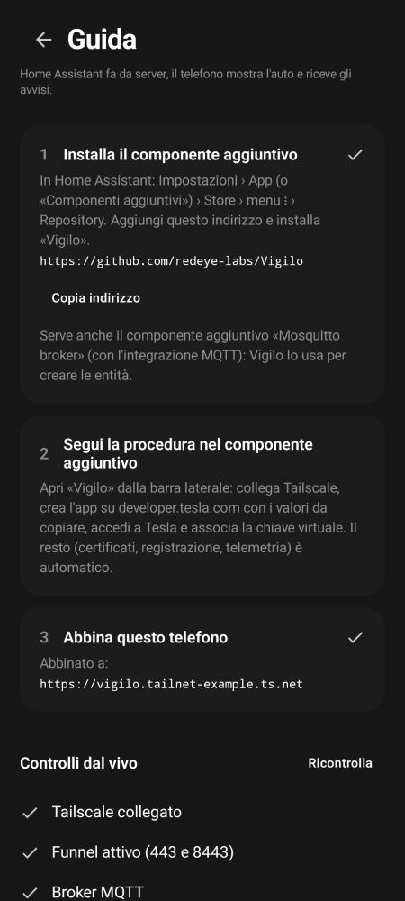

# Vigilo

**Real-time Sentry Mode alerts for your car, with Home Assistant as the backend and an Android app as the remote.**

[Versione italiana](README.md) · [MIT](LICENSE) license · Independent project, **not affiliated with Tesla**.

<p>
  
  
  
</p>

> The app UI is currently in Italian.

## How it works

- **Home Assistant is the backend.** The *Vigilo* add-on (called "apps" since HA 2026.2) receives Sentry Mode
  state in real time via Tesla **Fleet Telemetry** (**Aware** = someone near the car, **Panic** = alarm), signs
  commands with your virtual key (official vehicle-command library), renews tokens and the telemetry config
  on its own and publishes MQTT entities.
- **The Android app is the frontend.** Pair it by scanning a QR code; it shows status, map, history (including
  Aware/Panic events) and sends commands. No Tailscale needed on the phone.
- **No external servers, no router ports.** An embedded Tailscale node (`vigilo.<tailnet>.ts.net`) uses
  **Funnel** on ports 443 (public key, OAuth callback, app API) and 8443 (telemetry, mTLS passthrough).

## Requirements

- Home Assistant OS or Supervised (amd64/aarch64).
- **Mosquitto broker** app + MQTT integration.
- Free **Tailscale** account with **HTTPS Certificates** and the **`funnel` node attribute** enabled:
  ```json
  "nodeAttrs": [{ "target": ["autogroup:member"], "attr": ["funnel"] }]
  ```
- A Tesla developer account with a **new app** (e.g. "Vigilo").

## Install from scratch

[](https://my.home-assistant.io/redirect/supervisor_add_addon_repository/?repository_url=https%3A%2F%2Fgithub.com%2Fredeye-labs%2FVigilo)

1. Settings › **Apps** (formerly Add-ons) › Store › ⋮ › **Repositories** › `https://github.com/redeye-labs/Vigilo`.
2. Install **Vigilo** (first install builds locally: 5–15 min on a Raspberry Pi) and **Mosquitto broker**.
3. Open Vigilo from the sidebar and follow the wizard:

| Step | You (manual) | Vigilo (automatic) |
|---|---|---|
| Tailscale | click "Generate login link", approve device `vigilo` | opens Funnel on 443 and 8443 |
| Tesla app | create the app on developer.tesla.com using the copy buttons (Allowed Origin `https://vigilo.<tailnet>.ts.net`, Redirect URI `…/callback`); paste Client ID/Secret | stores credentials in `/data` only |
| Tesla login | sign in, pick region (EU/NA) and car | key pair, public key at `/.well-known/appspecific/com.tesla.3p.public-key.pem`, partner registration |
| Virtual key | open the link/QR on your phone with the Tesla app | checks pairing |
| Telemetry | nothing | CA + server cert, signed config sent, fleet-telemetry started |

> **Note:** the Tesla developer portal sometimes rejects the Allowed Origin / Redirect URI on the first try,
> or reports them as invalid even when they are correct. Retry or press **Update** again until they are saved,
> then double-check they are unchanged.
| Notifications | pick phones and throttle | Aware with throttle, Panic on the `alarm_stream` channel |
| Android app | install the app from [Releases](https://github.com/redeye-labs/Vigilo/releases/latest), open Settings → Collega a Home Assistant → Inquadra QR, and scan this QR. Do not tap «Rigenera» if an app is already paired. | token pairing; the step turns green once the app is connected |

**Download Vigilo only from the official repository** [github.com/redeye-labs/Vigilo](https://github.com/redeye-labs/Vigilo).

4. Install the latest app from **Releases**, or open [this link](https://github.com/redeye-labs/Vigilo/releases/latest/download/Vigilo.apk) on the phone (the wizard also has a “Scarica l'app” QR for the normal camera). Then open the in-app **Guide** and scan the pairing QR from inside Vigilo. Live checks turn green.

Starting with **1.2.0** the APK is signed with a new key. If you already have 1.1.x (or earlier), **uninstall it first**, then install 1.2.0 (or later) and pair again by scanning the QR.

Official signing certificate SHA-256 fingerprint:

`61:61:B9:CF:FE:C8:D1:30:43:51:5F:12:F1:44:C5:F8:F6:AB:AE:A0:8A:BE:33:D0:67:3F:CA:08:4F:00:3C:47`

Verify with: `apksigner verify --print-certs Vigilo-1.3.0.apk`

In **1.3.0**, Settings (when the app is paired with Home Assistant) has **Notifiche allarme anche dall'app** (off by default): Aware and Panic alerts also come from Vigilo, with a 15–20 second delay. **Suona anche in silenzioso** (on when the first option is on) uses the alarm volume.

### Blueprints (optional)

[](https://my.home-assistant.io/redirect/blueprint_import/?blueprint_url=https%3A%2F%2Fgithub.com%2Fredeye-labs%2FVigilo%2Fblob%2Fmain%2Fblueprints%2Fautomation%2Fvigilo%2Fsentinella_aware.yaml)
[](https://my.home-assistant.io/redirect/blueprint_import/?blueprint_url=https%3A%2F%2Fgithub.com%2Fredeye-labs%2FVigilo%2Fblob%2Fmain%2Fblueprints%2Fautomation%2Fvigilo%2Fsentinella_panic.yaml)

The add-on already sends notifications itself; use the blueprints only if you prefer HA automations (and turn the add-on's off). The Aware blueprint now has an optional “Suona come una sveglia” input (off by default) to use the `alarm_stream` channel. Re-import the blueprint from Settings → Automations & scenes → Blueprints (or the button above); existing automations keep the previous behaviour until you enable the new option.

## Install without Home Assistant (Docker)

> **Preview.** The Docker version lives on the `standalone-docker` branch and has not yet been tested with a
> real car. The Home Assistant add-on is still the recommended setup.

The same server as the add-on also runs in a Docker container on any always-on machine: a mini PC, a NAS,
a 64-bit Raspberry Pi 4/5 or a VPS. It works on amd64 and arm64. Without Home Assistant:

- car data goes through an **internal MQTT broker** that is only reachable inside the container;
- the wizard opens in a browser at `http://<server>:8099` and is **password-protected**;
- alerts come from the **Vigilo app**, with "Notifiche allarme anche dall'app". You can also add free
  **ntfy** for instant push. No Firebase needed.

**Requirements:** Docker with Compose v2.24 or later, a Tailscale account with HTTPS and Funnel (as above),
an app on the Tesla developer portal, and the Vigilo Android app 1.3 or later.

1. Get the project and prepare the configuration:
   ```bash
   git clone -b standalone-docker https://github.com/redeye-labs/Vigilo.git
   cd Vigilo/standalone
   cp .env.example .env
   nano .env
   ```
   Everything in `.env` is optional. If the Home Assistant add-on already runs in the same tailnet, set
   `VIGILO_TS_HOSTNAME=vigilo-docker` so the two nodes don't clash.
2. Start Vigilo:
   ```bash
   docker compose up -d --build
   ```
   The first build takes 5–15 minutes. Then check it started with `docker compose ps`: it should show
   `healthy`.
3. Read the wizard password:
   ```bash
   sudo cat data/ui_password
   ```
   Vigilo creates it on first start. To choose your own, set `VIGILO_UI_PASSWORD` in `.env`.
4. Open `http://<server-address>:8099` from a browser on your home network. User: `vigilo`.
5. Follow the same 7 steps as the add-on:
   - **Step 1, Tailscale:** click "Genera link di accesso" and approve the node. Alternatively, put a
     `TS_AUTHKEY` in `.env` before starting.
   - **Step 6, notifications:** the Home Assistant phone list is gone. Instead it shows instructions for
     the app and optional ntfy fields.
   - **Step 7:** scan the QR from inside Vigilo (Settings → Collega a Home Assistant → Inquadra QR). Then,
     in Settings, enable **"Notifiche allarme anche dall'app"**.

To update: `git pull && docker compose up -d --build`. Keys, tokens and pairing stay in `standalone/data`.
Back that folder up and never share it.

> **Do not forward port 8099 on your router.** Use it only from your home network or over Tailscale. Tesla
> and the app go through the Funnel, not through this port.

Details, variables, ntfy and troubleshooting: [standalone/README.md](standalone/README.md).

## Costs

Fleet API is pay-per-use with a monthly free credit. Vigilo does **no paid polling** and **never wakes the car**
to read or renew (streaming telemetry; the config is queued by Tesla). Only commands you send may wake it. A
**0 € spending limit** in the Tesla portal is already safe: requests beyond the credit are rejected, not billed.

## Migrating from the old setup

Configure the new add-on until every check is green, pair app 1.1, then run in the *Advanced SSH & Web Terminal*:

```bash
curl -fsSL https://raw.githubusercontent.com/redeye-labs/Vigilo/main/tools/ha-cleanup-old-setup.sh -o /tmp/vigilo-cleanup.sh && bash /tmp/vigilo-cleanup.sh
```

It asks before every step (uninstall Community TeslaFleet and Tesla HTTP Proxy, reset the old Funnel/Serve,
delete `/homeassistant/www/vigilo` and `/share/vigilo`, delete old automations one by one). Manually: shut down
the old Render service, delete the old Tesla developer app, remove the old virtual key from the car.

## Security

Secrets (client secret, tokens, private key, pairing token) live only in the add-on's `/data` (0600) or encrypted
on the phone (Android Keystore) and are never logged. The config UI is Ingress-only (Docker version: port 8099 with a password; never expose it to the internet). Exposed via Funnel: public
key, OAuth callback, token-protected app API, mTLS telemetry port.

## Build

- App: `./gradlew assembleRelease` (JDK 17+, Android SDK 36).
  Release signing does not use the debug key. Set these environment variables
  (never put the password in repository files):

  ```bash
  export VIGILO_KEYSTORE_PATH=/path/to/vigilo-release.jks
  export VIGILO_KEY_ALIAS=vigilo
  export VIGILO_KEYSTORE_PASSWORD  # keystore password, environment only
  ./gradlew assembleRelease
  ```

  Alternatively, a gitignored `keystore.properties` file may contain only
  `storeFile=/path/to/vigilo-release.jks` and `keyAlias=vigilo`. The password
  stays in `VIGILO_KEYSTORE_PASSWORD` only. If anything is missing, the release
  build fails with a clear error; there is no fallback to the debug key.

- Add-on server: `cd addon/vigilo/server && go build .` (Go 1.27).

Every app release on GitHub must attach **two** APK files: `Vigilo-x.y.z.apk` (versioned name) and **`Vigilo.apk`** (same file, stable name). The latter is what the download QR and
`https://github.com/redeye-labs/Vigilo/releases/latest/download/Vigilo.apk` use.

## Credits and licenses

The full list of third-party components, with licenses and URLs, is in
[THIRD_PARTY_LICENSES.md](THIRD_PARTY_LICENSES.md). Among others: teslamotors/fleet-telemetry and
teslamotors/vehicle-command (Apache 2.0), Tailscale tsnet (BSD-3-Clause), Eclipse Paho, osmdroid.
Map data © OpenStreetMap contributors.

## Trademarks

Tesla, Model 3, Model Y, Model S, Model X and Sentry Mode are trademarks of Tesla, Inc.
This project is not affiliated with, endorsed or supported by Tesla, Inc.
