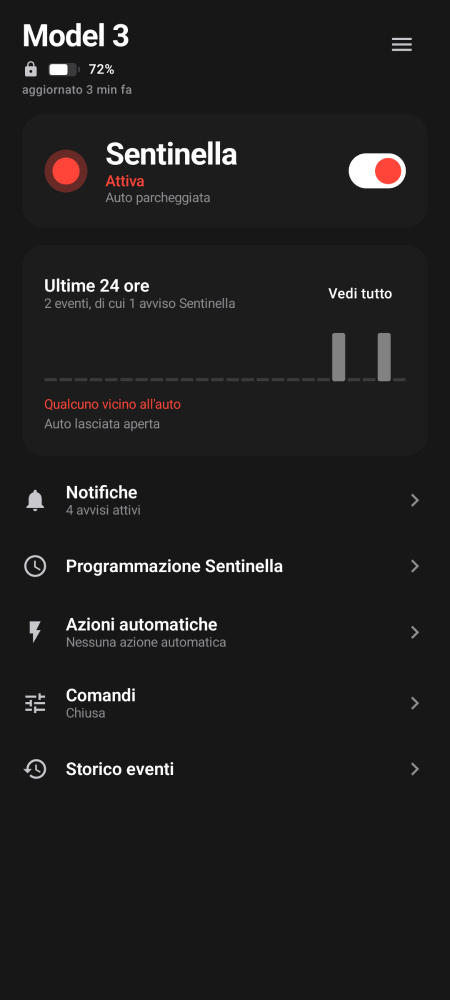
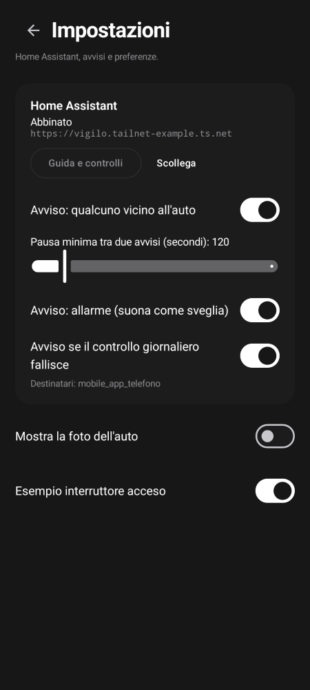

# Vigilo

**Real-time Sentry Mode alerts for your car, with Home Assistant as the backend and an Android app as the remote.**

[Versione italiana](README.md) · [MIT](LICENSE) license · Independent project, **not affiliated with Tesla**.

<p>
  
  
  
</p>

> The app UI is currently in Italian.

## How it works

- **Home Assistant is the backend.** The *Vigilo* add-on (called "apps" since HA 2026.2) receives Sentry Mode
  state in real time via Tesla **Fleet Telemetry** (**Aware** = someone near the car, **Panic** = alarm), signs
  commands with your virtual key (official vehicle-command library), renews tokens and the telemetry config
  on its own and publishes MQTT entities.
- **The Android app is the frontend.** Pair it by scanning a QR code; it shows status, map, history (including
  Aware/Panic events) and sends commands. No Tailscale needed on the phone.
- **No external servers, no router ports.** An embedded Tailscale node (`vigilo.<tailnet>.ts.net`) uses
  **Funnel** on ports 443 (public key, OAuth callback, app API) and 8443 (telemetry, mTLS passthrough).

## Requirements

- Home Assistant OS or Supervised (amd64/aarch64).
- **Mosquitto broker** app + MQTT integration.
- Free **Tailscale** account with **HTTPS Certificates** and the **`funnel` node attribute** enabled:
  ```json
  "nodeAttrs": [{ "target": ["autogroup:member"], "attr": ["funnel"] }]
  ```
- A Tesla developer account with a **new app** (e.g. "Vigilo").

## Install from scratch

[](https://my.home-assistant.io/redirect/supervisor_add_addon_repository/?repository_url=https%3A%2F%2Fgithub.com%2Fredeye-labs%2FVigilo)

1. Settings › **Apps** (formerly Add-ons) › Store › ⋮ › **Repositories** › `https://github.com/redeye-labs/Vigilo`.
2. Install **Vigilo** (first install builds locally: 5–15 min on a Raspberry Pi) and **Mosquitto broker**.
3. Open Vigilo from the sidebar and follow the wizard:

| Step | You (manual) | Vigilo (automatic) |
|---|---|---|
| Tailscale | click "Generate login link", approve device `vigilo` | opens Funnel on 443 and 8443 |
| Tesla app | create the app on developer.tesla.com using the copy buttons (Allowed Origin `https://vigilo.<tailnet>.ts.net`, Redirect URI `…/callback`); paste Client ID/Secret | stores credentials in `/data` only |
| Tesla login | sign in, pick region (EU/NA) and car | key pair, public key at `/.well-known/appspecific/com.tesla.3p.public-key.pem`, partner registration |
| Virtual key | open the link/QR on your phone with the Tesla app | checks pairing |
| Telemetry | nothing | CA + server cert, signed config sent, fleet-telemetry started |

> **Note:** the Tesla developer portal sometimes rejects the Allowed Origin / Redirect URI on the first try,
> or reports them as invalid even when they are correct. Retry or press **Update** again until they are saved,
> then double-check they are unchanged.
| Notifications | pick phones and throttle | Aware with throttle, Panic on the `alarm_stream` channel |
| Android app | scan the pairing QR | 256-bit token pairing |

4. Install `Vigilo-1.1.1.apk` from **Releases**, open the in-app **Guide**, scan the QR. Live checks turn green.

### Blueprints (optional)

[](https://my.home-assistant.io/redirect/blueprint_import/?blueprint_url=https%3A%2F%2Fgithub.com%2Fredeye-labs%2FVigilo%2Fblob%2Fmain%2Fblueprints%2Fautomation%2Fvigilo%2Fsentinella_aware.yaml)
[](https://my.home-assistant.io/redirect/blueprint_import/?blueprint_url=https%3A%2F%2Fgithub.com%2Fredeye-labs%2FVigilo%2Fblob%2Fmain%2Fblueprints%2Fautomation%2Fvigilo%2Fsentinella_panic.yaml)

The add-on already sends notifications itself; use the blueprints only if you prefer HA automations (and turn the add-on's off).

## Costs

Fleet API is pay-per-use with a monthly free credit. Vigilo does **no paid polling** and **never wakes the car**
to read or renew (streaming telemetry; the config is queued by Tesla). Only commands you send may wake it. A
**0 € spending limit** in the Tesla portal is already safe: requests beyond the credit are rejected, not billed.

## Migrating from the old setup

Configure the new add-on until every check is green, pair app 1.1, then run in the *Advanced SSH & Web Terminal*:

```bash
curl -fsSL https://raw.githubusercontent.com/redeye-labs/Vigilo/main/tools/ha-cleanup-old-setup.sh -o /tmp/vigilo-cleanup.sh && bash /tmp/vigilo-cleanup.sh
```

It asks before every step (uninstall Community TeslaFleet and Tesla HTTP Proxy, reset the old Funnel/Serve,
delete `/homeassistant/www/vigilo` and `/share/vigilo`, delete old automations one by one). Manually: shut down
the old Render service, delete the old Tesla developer app, remove the old virtual key from the car.

## Security

Secrets (client secret, tokens, private key, pairing token) live only in the add-on's `/data` (0600) or encrypted
on the phone (Android Keystore) and are never logged. The config UI is Ingress-only. Exposed via Funnel: public
key, OAuth callback, token-protected app API, mTLS telemetry port.

## Build

- App: `./gradlew assembleRelease` (JDK 17+, Android SDK 36).
- Add-on server: `cd addon/vigilo/server && go build .` (Go 1.27).

Uses teslamotors/fleet-telemetry and teslamotors/vehicle-command (Apache 2.0), Tailscale tsnet (BSD-3),
Eclipse Paho, osmdroid. Map data © OpenStreetMap contributors.

*Tesla and Model 3 are trademarks of their respective owners. This project is not affiliated with, endorsed or
supported by Tesla, Inc.*
