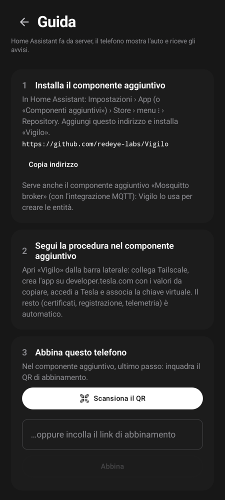

# Vigilo

**Avvisi Sentinella in tempo reale per la tua auto, con Home Assistant come server e un'app Android come telecomando.**

[English version](README.en.md) · Licenza [MIT](LICENSE) · Progetto indipendente, **non affiliato a Tesla**.

<p>
  
  
  
</p>

> **Nota:** gli screenshot Home e Impostazioni sono di una versione precedente alla 1.3.10. Le funzionalità aggiornate sono descritte qui sotto; sostituire le immagini quando saranno disponibili nuove schermate.

## Come funziona

```
Auto ──Fleet Telemetry (mTLS, 8443)──▶ Tailscale Funnel ──▶ ┌───────────────────────────────┐
                                                             │ Home Assistant                │
Tesla ◀──Fleet API / comandi firmati──────────────────────── │  app «Vigilo» (add-on)         │──▶ notifiche HA
                                                             │  · fleet-telemetry ufficiale  │──▶ entità MQTT
App Android Vigilo ◀──HTTPS + token di abbinamento──────────▶│  · firma comandi (vehicle-    │──▶ blueprint
                                                             │    command), OAuth, rinnovi   │
                                                             └───────────────────────────────┘
```

- **Home Assistant è il backend**: il componente aggiuntivo (in HA 2026.2+ si chiamano «app») *Vigilo* riceve
  in tempo reale lo stato della Sentinella (**Aware** = qualcuno vicino all'auto, **Panic** = allarme), firma i
  comandi con la chiave virtuale, rinnova token e configurazione da solo e crea le entità MQTT.
- **L'app Android è il frontend**: si abbina con un QR, mostra stato, mappa, storico (compresi gli eventi
  Aware/Panic) e invia i comandi. Non serve Tailscale sul telefono.
- **Niente server esterni** (niente Render, niente VPS), niente porte aperte sul router: il Funnel di
  Tailscale pubblica solo ciò che Tesla deve raggiungere.

## Due modi di installarlo

Il server Vigilo è lo stesso programma, in due confezioni. L'app Android è la stessa per tutte e due.

| | **A. Home Assistant** | **B. Docker, senza Home Assistant** |
|---|---|---|
| Per chi | hai già Home Assistant | non hai Home Assistant: PC Windows, mini PC, NAS, Raspberry Pi |
| Come si installa | componente aggiuntivo dallo Store di HA | `Vigilo-Setup.exe` (Windows) o una riga di comando (Linux) |
| Avvisi | app Home Assistant e/o app Vigilo | app Vigilo e/o ntfy |
| Aggiornare | Store di HA › Vigilo › Aggiorna | menu Start › «Vigilo – Aggiorna» (Linux: rilancia la riga) |
| Istruzioni | [Installazione da zero](#installazione-da-zero) | [Installazione senza Home Assistant](#installazione-senza-home-assistant-docker) |

In tutte e due il server fa anche il **Programma Sentinella** (accendi/spegni a orari fissi) e le **Azioni
automatiche** (fari e/o clacson quando la Sentinella rileva qualcuno), anche con il telefono spento.

## Cosa serve (Home Assistant)

- Home Assistant OS o Supervised (amd64 o aarch64, es. Raspberry Pi 4/5).
- App **Mosquitto broker** + integrazione MQTT.
- Account **Tailscale** gratuito con **HTTPS Certificates** e attributo **funnel** abilitati.
- Account sviluppatore Tesla (developer.tesla.com) con una **nuova app**, ad esempio «Vigilo».
- Un telefono Android 8+ (per l'app; le notifiche funzionano anche solo con l'app Home Assistant).

## Installazione da zero

> I riquadri «📷» sono segnaposto per gli screenshot della tua installazione.

### 1. Tailscale (una volta)

1. Su [login.tailscale.com](https://login.tailscale.com) › **DNS**: abilita *MagicDNS* e *HTTPS Certificates*.
2. **Access controls**: aggiungi l'attributo funnel (se non c'è già):
   ```json
   "nodeAttrs": [{ "target": ["autogroup:member"], "attr": ["funnel"] }]
   ```
📷 *Screenshot: pagina DNS con HTTPS Certificates attivo*

### 2. Componente aggiuntivo

[](https://my.home-assistant.io/redirect/supervisor_add_addon_repository/?repository_url=https%3A%2F%2Fgithub.com%2Fredeye-labs%2FVigilo)

1. Impostazioni › **App** (prima «Componenti aggiuntivi») › Store › ⋮ › **Repository** › `https://github.com/redeye-labs/Vigilo`.
2. Installa **Vigilo** (la prima volta compila sul tuo HA: 5–15 minuti su Raspberry Pi) e **Mosquitto broker**.
3. Avvia Vigilo e aprilo dalla barra laterale.

📷 *Screenshot: Vigilo nello Store*

### 3. Procedura guidata (nella pagina Vigilo)

| Passo | Cosa fai tu (manuale) | Cosa fa Vigilo (automatico) |
|---|---|---|
| Tailscale | «Genera link di accesso», autorizzi il dispositivo `vigilo` | apre il Funnel su 443 e 8443 |
| App Tesla | su developer.tesla.com crei l'app «Vigilo» copiando *Allowed Origin* e *Redirect URI* con i pulsanti «Copia»; scegli gli scope; incolli Client ID e Client Secret | salva le credenziali solo in `/data` |
| Login Tesla | «Accedi con Tesla», scegli regione (EU/NA) e auto | genera la chiave, pubblica la chiave pubblica su `/.well-known/appspecific/…`, registra il dominio presso Tesla |
| Chiave virtuale | apri il link/QR sul telefono con l'app Tesla e confermi | verifica l'associazione |
| Telemetria | niente | crea CA e certificato, firma e invia la configurazione, avvia fleet-telemetry |
| Notifiche | scegli i telefoni e la pausa tra due avvisi | Aware con pausa, Panic sul canale sveglia (`alarm_stream`) |
| App Android | inquadri il QR «Scarica l'app» con la fotocamera del telefono (o [scarichi l'APK](https://github.com/redeye-labs/Vigilo/releases/latest/download/Vigilo.apk)), poi inquadri il QR «Collega l'app» da dentro Vigilo (Guida → Scansiona il QR). Non usare «Rigenera» se l'app è già collegata. | abbinamento con token; il passo diventa verde quando l'app è collegata |

Valori per il portale Tesla (te li dà la procedura già pronti):

- **Allowed Origin**: `https://vigilo.<tuo-tailnet>.ts.net`
- **Allowed Redirect URI**: `https://vigilo.<tuo-tailnet>.ts.net/callback`
- **Scope**: Vehicle Information, Vehicle Location, Vehicle Commands, Vehicle Charging Management.

> **Nota:** a volte il portale Tesla rifiuta Allowed Origin o Redirect URI al primo tentativo, o dice che
> non sono validi anche se sono giusti. È un comportamento del loro sito: riprova o premi di nuovo
> **Update** finché non risultano salvati, poi ricontrolla che siano rimasti identici.

📷 *Screenshot: procedura guidata con tutti i controlli verdi*

### 4. App Android

**Scarica Vigilo solo dal repository ufficiale** [github.com/redeye-labs/Vigilo](https://github.com/redeye-labs/Vigilo).

1. Scarica l'ultima app dalla pagina **Releases** oppure, dal telefono, apri [questo link](https://github.com/redeye-labs/Vigilo/releases/latest/download/Vigilo.apk) (o inquadra il QR «Scarica l'app» nella procedura guidata) e installala.
2. Al primo avvio si apre la **Guida**: premi «Scansiona il QR» e inquadra il QR dell'ultimo passo.
3. La guida mostra i **controlli dal vivo** del componente aggiuntivo: quando sono tutti spuntati hai finito.

**Firma APK e aggiornamenti.** Nelle vecchie build era usato il certificato SHA-256
`61:61:B9:CF:FE:C8:D1:30:43:51:5F:12:F1:44:C5:F8:F6:AB:AE:A0:8A:BE:33:D0:67:3F:CA:08:4F:00:3C:47`.
Il nuovo [processo di firma](docs/SIGNING_FROM_PHONE.md) usa un keystore persistente diverso. Android non può installare un aggiornamento con un certificato di firma differente: al passaggio alla nuova firma occorre disinstallare la versione precedente una volta, con possibile perdita dei dati locali. Conserva le informazioni per riabbinare l'app al server prima di farlo.
Verifica il certificato dell'APK effettivamente scaricato con `apksigner verify --print-certs Vigilo.apk`; un Artifacts di GitHub Actions non equivale automaticamente a una Release pubblicata.

Dalla **1.3.10**, nella **Home** c'è **Monitoraggio avvisi**: lo switch attiva o disattiva il monitoraggio Android indipendentemente dalla Sentinella Tesla. La scheda riporta la data di inizio sessione, gli eventi registrati e gli avvisi Sentinella nella sessione corrente o nell'ultima terminata; il grafico «Ultime 24 ore» è stato tolto. Sono conteggiati gli eventi nello storico **locale disponibile** (fino agli ultimi 500 caricati), non necessariamente tutti gli eventi del server né le notifiche effettivamente recapitate. Apri **Storico eventi** per consultare i dettagli. Nella sezione **Impostazioni → Avvisi sul telefono** resta **Suona anche in silenzioso**, che usa il volume della sveglia, oltre alle indicazioni sul risparmio batteria quando necessarie. Gli avvisi Aware/Panic dall'app possono arrivare con un ritardo tipico di 15–20 secondi.

Dalla **1.3.1** la notifica fissa (se l'opzione è attiva) mostra batteria, autonomia e stato della Sentinella, per esempio «🔋 78% · 412 km · Sentinella attiva», e si aggiorna da sola, senza suonare. Dalla **1.3.2** l'icona in alto è di nuovo il simbolo della Sentinella. Dalla **1.3.3** ogni avviso ha il suo suono: sirena per l'allarme, doppio bip quando qualcuno è vicino all'auto, tono discreto per avvisi e problemi. In Impostazioni › Suoni c'è «Prova suono» per ciascuno. Dalla **1.3.4** il servizio delle notifiche dall'app riparte da solo dopo un aggiornamento dell'app o il riavvio del telefono. Dalla **1.3.5** l'app funziona solo con un server Vigilo (componente aggiuntivo di Home Assistant o versione Docker): la vecchia modalità diretta è stata tolta e i suoi dati (token, client secret) vengono cancellati dal telefono all'aggiornamento. In Impostazioni puoi scegliere il nome dell'auto e una tua foto, e ogni gruppo di impostazioni ha il suo riquadro. Dalla **1.3.6** tornano le **Azioni automatiche** (fari e/o clacson quando la Sentinella rileva qualcuno o scatta l'allarme, con pausa minima e fascia oraria facoltativa; spente di default) e il **Programma Sentinella** ha una schermata nuova. Tutte e due le esegue il server Vigilo (dalla 1.0.7), anche a telefono spento: con un server più vecchio il programma resta sul telefono finché non aggiorni. Dalla **1.3.7** la schermata Comandi mostra di nuovo temperatura interna ed esterna, contachilometri e bagagliaio/frunk (serve il server 1.0.8).



### 5. Blueprint (facoltativi)

Il componente aggiuntivo invia già le notifiche da solo. Se preferisci gestirle con le automazioni di HA
(e disattivi quelle del componente, per non riceverle doppie):

[](https://my.home-assistant.io/redirect/blueprint_import/?blueprint_url=https%3A%2F%2Fgithub.com%2Fredeye-labs%2FVigilo%2Fblob%2Fmain%2Fblueprints%2Fautomation%2Fvigilo%2Fsentinella_aware.yaml)
**Aware** – qualcuno vicino all'auto: più telefoni, pausa configurabile. Opzione facoltativa «Suona come una sveglia» (spenta di default) per usare il canale `alarm_stream` anche in silenzioso o in «Non disturbare». Se hai già importato il blueprint, ri-importalo da Impostazioni → Automazioni e scene → Blueprint (oppure dal pulsante qui sopra): le automazioni già create restano come prima finché non attivi la nuova opzione.

[](https://my.home-assistant.io/redirect/blueprint_import/?blueprint_url=https%3A%2F%2Fgithub.com%2Fredeye-labs%2FVigilo%2Fblob%2Fmain%2Fblueprints%2Fautomation%2Fvigilo%2Fsentinella_panic.yaml)
**Panic** – allarme: canale `alarm_stream` (suona come una sveglia anche in «Non disturbare»).

## Installazione senza Home Assistant (Docker)

> Se hai già Home Assistant, il componente aggiuntivo qui sopra è la strada più semplice. I file per
> Windows e l'immagine pronta sono nella release [Docker 1.0.8](https://github.com/redeye-labs/Vigilo/releases/tag/docker-v1.0.8).

Vigilo può funzionare anche senza Home Assistant, su un computer che resta sempre acceso: un PC Windows, un
mini PC, un NAS o un Raspberry Pi 4/5. Un programma di installazione fa quasi tutto da solo.

**Cosa ti serve**

- Un PC o un server che resta sempre acceso. A **WSL** e **Docker** pensa l'installatore: se mancano li
  installa, ma prima ti chiede conferma.
- Un account [Tailscale](https://tailscale.com) gratuito, con HTTPS e Funnel attivi (vedi sopra).
- Un'app sul [portale sviluppatori Tesla](https://developer.tesla.com). La pagina di Vigilo ti mostra i valori
  da copiare.
- L'app Android Vigilo 1.3 o successiva.

### Windows 10 / 11

1. Scarica **[Vigilo-Setup.exe](https://github.com/redeye-labs/Vigilo/releases/download/docker-v1.0.8/Vigilo-Setup.exe)**.
2. Aprilo con **doppio clic**. Se compare la schermata blu «Windows ha protetto il PC», premi
   **«Ulteriori informazioni»** e poi **«Esegui comunque»**: il file non ha ancora una firma digitale.
   Premi **Avanti** e poi **Fine**. Non servono permessi di amministratore.
3. Si apre una finestra che fa il resto. Se deve aggiornare WSL o installare Docker Desktop, prima ti
   chiede conferma. Se poi serve un riavvio del PC, te lo dice: dopo il riavvio apri dal menu Start
   **«Vigilo – Aggiorna»** e riprende da dove si era fermato.
4. Quando ti chiede il **nome**, premi **Invio**: resta `vigilo-docker`. Se hai già Vigilo su Home Assistant,
   lascia `vigilo-docker` o scegli un nome diverso da quello che usi lì.
5. **Aspetta qualche minuto.** La prima volta scarica circa 70 MB.
6. Alla fine il browser si apre da solo su **http://localhost:8099** e chiede di accedere:
   - **Nome utente: `vigilo`** (è sempre questo).
   - **Password:** Vigilo la crea da solo la prima volta. La trovi scritta alla fine della finestra di
     installazione, nel riquadro «PER ENTRARE NELLA PAGINA DI VIGILO», ed è già copiata negli appunti:
     nel campo password premi **Ctrl+V**. Per rivederla in seguito apri dal menu Start **«Vigilo – Mostra
     password»**, oppure apri con il Blocco note il file `%USERPROFILE%\Vigilo\standalone\data\ui_password`.
7. Segui i **7 passi** della pagina, gli stessi del componente aggiuntivo. Al passo 7 inquadra il QR da
   dentro Vigilo (Guida → Scansiona il QR), poi attiva **«Monitoraggio avvisi»**
   nella schermata principale dell’app.

Nel menu Start trovi **«Vigilo – Apri pagina»**, **«Vigilo – Mostra password»** e **«Vigilo – Aggiorna»**. «Aggiorna» scarica le ultime
correzioni e conserva dati e impostazioni. Per disinstallare: **Impostazioni → App → App installate →
Vigilo (Docker) → Disinstalla**. Prima di cancellare i dati ti chiede conferma; se non confermi, restano.

**Seconda possibilità: [Vigilo-Installer.bat](https://github.com/redeye-labs/Vigilo/releases/download/docker-v1.0.8/Vigilo-Installer.bat).** Scaricalo e aprilo con doppio
clic. Se il browser avvisa che il file non viene scaricato spesso, scegli «Mantieni». Poi segui i passi da
4 a 7.

**Terza possibilità, senza scaricare niente:** premi **Win + R**, incolla questa riga e premi Invio. Poi
segui i passi da 4 a 7.

```
powershell -ExecutionPolicy Bypass -c "irm https://raw.githubusercontent.com/redeye-labs/Vigilo/main/standalone/install-windows.ps1 | iex"
```

Senza l'`.exe`: per aggiornare riapri il `.bat`; per disinstallare fai clic destro su
`%USERPROFILE%\Vigilo\standalone\uninstall-windows.ps1` → «Esegui con PowerShell».

### Linux, NAS, Raspberry Pi

1. Apri un terminale sul server, oppure collegati con SSH, e incolla:
   ```bash
   curl -fsSL https://raw.githubusercontent.com/redeye-labs/Vigilo/main/standalone/install.sh | bash
   ```
2. Se Docker manca, l'installatore ti chiede se vuoi installarlo. Rispondi di sì.
3. Quando ti chiede il **nome**, premi **Invio**: resta `vigilo-docker`.
4. **Aspetta qualche minuto** la prima volta (scarica circa 70 MB).
5. Alla fine compare il riquadro «PER ENTRARE NELLA PAGINA DI VIGILO» con l'indirizzo (per esempio
   `http://192.168.x.x:8099`), il **nome utente `vigilo`** e la **password**. Apri l'indirizzo dal browser di un
   computer di casa. Per rivedere la password: `sudo cat ~/vigilo/standalone/data/ui_password`.
6. Segui i **7 passi** della pagina, come sopra.

**Aggiornare:** rilancia la stessa riga. **Disinstallare:** `bash ~/vigilo/standalone/install.sh --uninstall`.

> **Importante:** non aprire la porta 8099 sul router e non condividere la cartella `standalone/data`, perché
> contiene le chiavi. Tesla e l'app passano da Tailscale Funnel, non da questa porta.

<details>
<summary><b>Installazione a mano (per esperti)</b></summary>

Senza Home Assistant, i dati dall'auto passano da un broker MQTT interno al container, la pagina è protetta
da password e gli avvisi li manda l'app Vigilo, con ntfy come opzione gratuita. Serve Docker con Compose v2.

1. Scarica il progetto e prepara la configurazione:
   ```bash
   git clone https://github.com/redeye-labs/Vigilo.git
   cd Vigilo/standalone
   cp .env.example .env
   nano .env
   ```
   Le voci di `.env` sono tutte facoltative. Se hai già Vigilo su Home Assistant nello stesso tailnet, scrivi
   `VIGILO_TS_HOSTNAME=vigilo-docker`.
2. Avvia Vigilo con `docker compose up -d --build` (compila dal sorgente: 5–15 minuti). Poi controlla con
   `docker compose ps` che risulti `healthy`.
3. Leggi la password con `sudo cat data/ui_password`. In alternativa, impostala tu con `VIGILO_UI_PASSWORD`
   nel file `.env`.
4. Apri `http://<indirizzo-del-server>:8099` (utente `vigilo`) e segui i 7 passi. Al passo 1 puoi usare
   «Genera link di accesso» oppure una chiave `TS_AUTHKEY` nel file `.env`. Al passo 6 trovi le istruzioni
   per l'app e i campi per ntfy.

Aggiornare: `git pull && docker compose up -d --build`. Dettagli, variabili, ntfy e soluzione dei problemi:
[standalone/README.md](standalone/README.md).

</details>

## Costi

La Fleet API di Tesla è a consumo, con un credito mensile gratuito. Vigilo **non fa letture periodiche a
pagamento** e **non sveglia mai l'auto** per leggere o rinnovare: lo stato arriva dalla telemetria in streaming,
la configurazione viene accodata da Tesla e l'auto la riceve al risveglio. Solo i comandi che chiedi tu possono
svegliarla. Se nel portale Tesla hai già impostato un **limite di spesa a 0 €**, sei al sicuro: oltre il
credito gratuito le richieste vengono rifiutate, non addebitate.

## Manutenzione automatica

- Rinnovo del token Tesla e della configurazione telemetria (prima dei 364 giorni), senza svegliare l'auto.
- Controllo giornaliero con notifica in HA se qualcosa non va (Funnel, chiave pubblica, MQTT, token…).

## Migrazione dalla vecchia installazione

Se usavi la versione precedente (Community TeslaFleet + Tesla HTTP Proxy + companion su Render + Funnel
configurato a mano + automazioni copiate):

1. Installa e configura il nuovo componente aggiuntivo **finché tutti i controlli sono verdi**.
2. Installa l'app 1.1 (è un'app nuova: si affianca alla vecchia) e abbinala.
3. Nel terminale **Advanced SSH & Web Terminal** esegui lo script di pulizia (chiede conferma per ogni passo,
   non cancella nulla se premi Invio):
   ```bash
   curl -fsSL https://raw.githubusercontent.com/redeye-labs/Vigilo/main/tools/ha-cleanup-old-setup.sh -o /tmp/vigilo-cleanup.sh && bash /tmp/vigilo-cleanup.sh
   ```
   Disinstalla le vecchie app, azzera il vecchio Funnel/Serve, cancella `/homeassistant/www/vigilo` e
   `/share/vigilo`, elenca le vecchie automazioni e le elimina solo se confermi.
4. A mano: sospendi/elimina il servizio su **Render**; elimina la vecchia app su developer.tesla.com; togli la
   vecchia chiave virtuale dall'auto (Comandi › Blocchi); disinstalla la vecchia app Vigilo 1.0.x.

## Sicurezza e privacy

- Client Secret, token, chiave privata e token di abbinamento restano **solo** in `/data` del componente
  aggiuntivo (0600) o cifrati sul telefono (Android Keystore). Mai nei log.
- La pagina di configurazione è raggiungibile solo dall'Ingress di Home Assistant (nella versione Docker:
  dalla porta 8099 con password, da non esporre su internet).
- Su internet sono esposti solo: chiave pubblica, ritorno del login, API dell'app (token a 256 bit,
  rigenerabile) e porta telemetria (mTLS).

## Struttura del repository

| Percorso | Contenuto |
|---|---|
| `repository.yaml`, `addon/vigilo/` | componente aggiuntivo Home Assistant (server Go + fleet-telemetry ufficiale) |
| `app/` | app Android (Kotlin, Jetpack Compose) |
| `blueprints/` | blueprint Aware e Panic |
| `standalone/` | versione Docker senza Home Assistant (Dockerfile, docker-compose.yml) |
| `tools/ha-cleanup-old-setup.sh` | pulizia della vecchia installazione |
| `docs/` | icona e screenshot |

## Compilare

- App: `./gradlew assembleRelease` (JDK 17+, Android SDK 36) → `app/build/outputs/apk/release/`.
  La firma di rilascio non usa la chiave di sviluppo: imposta queste variabili d'ambiente
  (la password non va mai nei file del repository):

  ```bash
  export VIGILO_KEYSTORE_PATH=/percorso/del/vigilo-release.jks
  export VIGILO_KEY_ALIAS=vigilo
  export VIGILO_KEYSTORE_PASSWORD  # la password della chiave, solo in ambiente
  ./gradlew assembleRelease
  ```

  In alternativa, un file `keystore.properties` (è nel `.gitignore`) può contenere solo
  `storeFile=/percorso/del/vigilo-release.jks` e `keyAlias=vigilo`. La password resta
  esclusivamente in `VIGILO_KEYSTORE_PASSWORD`. Se manca qualcosa, la build di rilascio
  fallisce con un errore chiaro: non c'è alcun fallback alla chiave debug.

- Server: `cd addon/vigilo/server && go build .` (Go 1.27). Test di integrazione facoltativo con un broker MQTT e il binario fleet-telemetry: vedi `integration_test.go`.

Per compilare automaticamente l'APK firmato si usa [Vigilo APK firmato](https://github.com/redeye-labs/Vigilo/actions/workflows/signed-release.yml): le modifiche dell'app su `main` avviano la build e caricano `Vigilo.apk` negli **Artifacts** dell'esecuzione. La pubblicazione in **GitHub Releases** è separata: il workflow deve essere avviato manualmente con `publish_release=true`. Finché non viene pubblicata una nuova Release, `releases/latest/download/Vigilo.apk` può puntare a una versione precedente o non essere disponibile. Controlla la firma e la compatibilità dell'aggiornamento prima di distribuire l'APK.

## Crediti e licenze

L'elenco completo dei componenti di terze parti, con licenza e indirizzo, è in
[THIRD_PARTY_LICENSES.md](THIRD_PARTY_LICENSES.md). Tra gli altri: [teslamotors/fleet-telemetry](https://github.com/teslamotors/fleet-telemetry)
e [teslamotors/vehicle-command](https://github.com/teslamotors/vehicle-command) (Apache 2.0),
Tailscale `tsnet` (BSD-3-Clause), Eclipse Paho MQTT, osmdroid. Mappe © OpenStreetMap contributors.
Foto auto facoltativa: Ethan Llamas, Wikimedia Commons, CC BY-SA 4.0.

## Marchi

Tesla, Model 3, Model Y, Model S, Model X e Sentinella (Sentry Mode) sono marchi di Tesla, Inc.
Questo progetto non è affiliato, approvato o supportato da Tesla, Inc.
