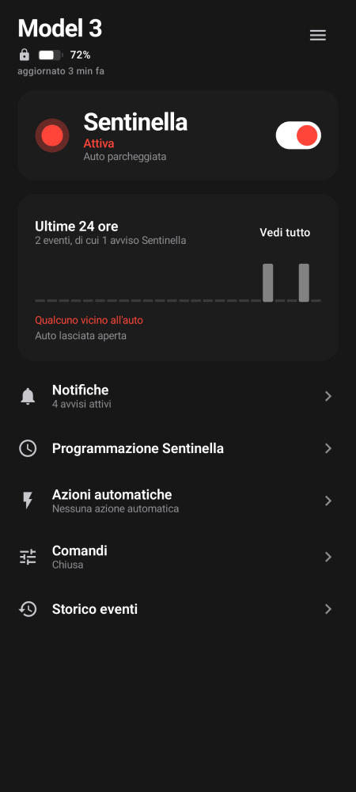
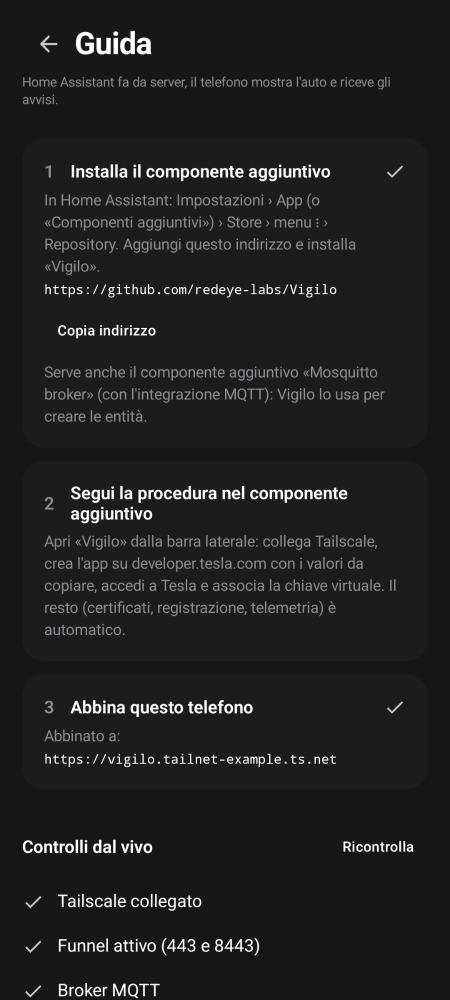
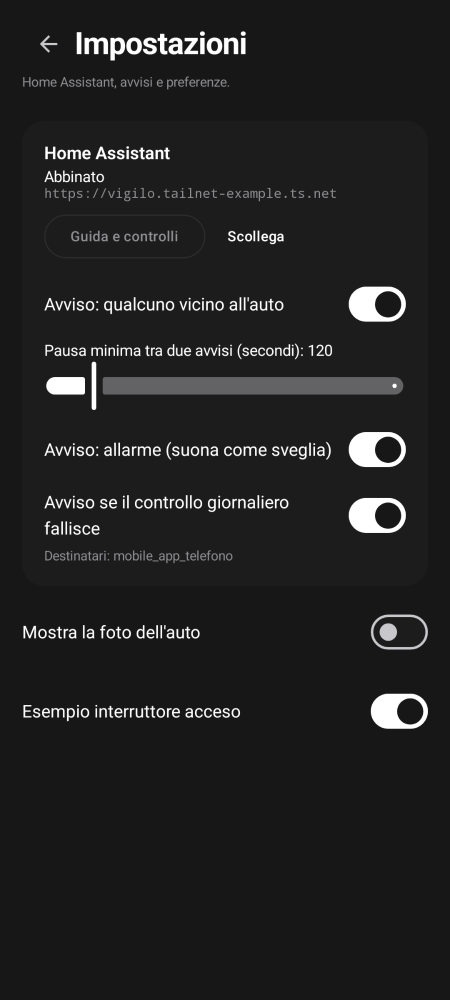

# Vigilo

**Avvisi Sentinella in tempo reale per la tua auto, con Home Assistant come server e un'app Android come telecomando.**

[English version](README.en.md) · Licenza [MIT](LICENSE) · Progetto indipendente, **non affiliato a Tesla**.

<p>
  
  
  
</p>

## Come funziona

```
Auto ──Fleet Telemetry (mTLS, 8443)──▶ Tailscale Funnel ──▶ ┌───────────────────────────────┐
                                                             │ Home Assistant                │
Tesla ◀──Fleet API / comandi firmati──────────────────────── │  app «Vigilo» (add-on)         │──▶ notifiche HA
                                                             │  · fleet-telemetry ufficiale  │──▶ entità MQTT
App Android Vigilo ◀──HTTPS + token di abbinamento──────────▶│  · firma comandi (vehicle-    │──▶ blueprint
                                                             │    command), OAuth, rinnovi   │
                                                             └───────────────────────────────┘
```

- **Home Assistant è il backend**: il componente aggiuntivo (in HA 2026.2+ si chiamano «app») *Vigilo* riceve
  in tempo reale lo stato della Sentinella (**Aware** = qualcuno vicino all'auto, **Panic** = allarme), firma i
  comandi con la chiave virtuale, rinnova token e configurazione da solo e crea le entità MQTT.
- **L'app Android è il frontend**: si abbina con un QR, mostra stato, mappa, storico (compresi gli eventi
  Aware/Panic) e invia i comandi. Non serve Tailscale sul telefono.
- **Niente server esterni** (niente Render, niente VPS), niente porte aperte sul router: il Funnel di
  Tailscale pubblica solo ciò che Tesla deve raggiungere.

## Cosa serve

- Home Assistant OS o Supervised (amd64 o aarch64, es. Raspberry Pi 4/5).
- App **Mosquitto broker** + integrazione MQTT.
- Account **Tailscale** gratuito con **HTTPS Certificates** e attributo **funnel** abilitati.
- Account sviluppatore Tesla (developer.tesla.com) con una **nuova app**, ad esempio «Vigilo».
- Un telefono Android 8+ (per l'app; le notifiche funzionano anche solo con l'app Home Assistant).

## Installazione da zero

> I riquadri «📷» sono segnaposto per gli screenshot della tua installazione.

### 1. Tailscale (una volta)

1. Su [login.tailscale.com](https://login.tailscale.com) › **DNS**: abilita *MagicDNS* e *HTTPS Certificates*.
2. **Access controls**: aggiungi l'attributo funnel (se non c'è già):
   ```json
   "nodeAttrs": [{ "target": ["autogroup:member"], "attr": ["funnel"] }]
   ```
📷 *Screenshot: pagina DNS con HTTPS Certificates attivo*

### 2. Componente aggiuntivo

[](https://my.home-assistant.io/redirect/supervisor_add_addon_repository/?repository_url=https%3A%2F%2Fgithub.com%2Fredeye-labs%2FVigilo)

1. Impostazioni › **App** (prima «Componenti aggiuntivi») › Store › ⋮ › **Repository** › `https://github.com/redeye-labs/Vigilo`.
2. Installa **Vigilo** (la prima volta compila sul tuo HA: 5–15 minuti su Raspberry Pi) e **Mosquitto broker**.
3. Avvia Vigilo e aprilo dalla barra laterale.

📷 *Screenshot: Vigilo nello Store*

### 3. Procedura guidata (nella pagina Vigilo)

| Passo | Cosa fai tu (manuale) | Cosa fa Vigilo (automatico) |
|---|---|---|
| Tailscale | «Genera link di accesso», autorizzi il dispositivo `vigilo` | apre il Funnel su 443 e 8443 |
| App Tesla | su developer.tesla.com crei l'app «Vigilo» copiando *Allowed Origin* e *Redirect URI* con i pulsanti «Copia»; scegli gli scope; incolli Client ID e Client Secret | salva le credenziali solo in `/data` |
| Login Tesla | «Accedi con Tesla», scegli regione (EU/NA) e auto | genera la chiave, pubblica la chiave pubblica su `/.well-known/appspecific/…`, registra il dominio presso Tesla |
| Chiave virtuale | apri il link/QR sul telefono con l'app Tesla e confermi | verifica l'associazione |
| Telemetria | niente | crea CA e certificato, firma e invia la configurazione, avvia fleet-telemetry |
| Notifiche | scegli i telefoni e la pausa tra due avvisi | Aware con pausa, Panic sul canale sveglia (`alarm_stream`) |
| App Android | inquadri il QR «Scarica l'app» con la fotocamera del telefono (o [scarichi l'APK](https://github.com/redeye-labs/Vigilo/releases/latest/download/Vigilo.apk)), poi inquadri il QR «Collega l'app» da dentro Vigilo (Impostazioni → Collega a Home Assistant → Inquadra QR). Non usare «Rigenera» se l'app è già collegata. | abbinamento con token; il passo diventa verde quando l'app è collegata |

Valori per il portale Tesla (te li dà la procedura già pronti):

- **Allowed Origin**: `https://vigilo.<tuo-tailnet>.ts.net`
- **Allowed Redirect URI**: `https://vigilo.<tuo-tailnet>.ts.net/callback`
- **Scope**: Vehicle Information, Vehicle Location, Vehicle Commands, Vehicle Charging Management.

> **Nota:** a volte il portale Tesla rifiuta Allowed Origin o Redirect URI al primo tentativo, o dice che
> non sono validi anche se sono giusti. È un comportamento del loro sito: riprova o premi di nuovo
> **Update** finché non risultano salvati, poi ricontrolla che siano rimasti identici.

📷 *Screenshot: procedura guidata con tutti i controlli verdi*

### 4. App Android

**Scarica Vigilo solo dal repository ufficiale** [github.com/redeye-labs/Vigilo](https://github.com/redeye-labs/Vigilo).

1. Scarica l'ultima app dalla pagina **Releases** oppure, dal telefono, apri [questo link](https://github.com/redeye-labs/Vigilo/releases/latest/download/Vigilo.apk) (o inquadra il QR «Scarica l'app» nella procedura guidata) e installala.
2. Al primo avvio si apre la **Guida**: premi «Scansiona il QR» e inquadra il QR dell'ultimo passo.
3. La guida mostra i **controlli dal vivo** del componente aggiuntivo: quando sono tutti spuntati hai finito.

Dalla **1.2.0** la chiave di firma dell'APK è nuova. Se hai già la 1.1.x (o precedente), **disinstallala prima**,
poi installa la 1.2.0 e rabbina l'app inquadrando di nuovo il QR.

Impronta SHA-256 del certificato di firma ufficiale:

`''' + FP + '''`

Puoi verificarla con: `apksigner verify --print-certs Vigilo-1.2.0.apk`


### 5. Blueprint (facoltativi)

Il componente aggiuntivo invia già le notifiche da solo. Se preferisci gestirle con le automazioni di HA
(e disattivi quelle del componente, per non riceverle doppie):

[](https://my.home-assistant.io/redirect/blueprint_import/?blueprint_url=https%3A%2F%2Fgithub.com%2Fredeye-labs%2FVigilo%2Fblob%2Fmain%2Fblueprints%2Fautomation%2Fvigilo%2Fsentinella_aware.yaml)
**Aware** – qualcuno vicino all'auto: più telefoni, pausa configurabile.

[](https://my.home-assistant.io/redirect/blueprint_import/?blueprint_url=https%3A%2F%2Fgithub.com%2Fredeye-labs%2FVigilo%2Fblob%2Fmain%2Fblueprints%2Fautomation%2Fvigilo%2Fsentinella_panic.yaml)
**Panic** – allarme: canale `alarm_stream` (suona come una sveglia anche in «Non disturbare»).

## Costi

La Fleet API di Tesla è a consumo, con un credito mensile gratuito. Vigilo **non fa letture periodiche a
pagamento** e **non sveglia mai l'auto** per leggere o rinnovare: lo stato arriva dalla telemetria in streaming,
la configurazione viene accodata da Tesla e l'auto la riceve al risveglio. Solo i comandi che chiedi tu possono
svegliarla. Se nel portale Tesla hai già impostato un **limite di spesa a 0 €**, sei al sicuro: oltre il
credito gratuito le richieste vengono rifiutate, non addebitate.

## Manutenzione automatica

- Rinnovo del token Tesla e della configurazione telemetria (prima dei 364 giorni), senza svegliare l'auto.
- Controllo giornaliero con notifica in HA se qualcosa non va (Funnel, chiave pubblica, MQTT, token…).

## Migrazione dalla vecchia installazione

Se usavi la versione precedente (Community TeslaFleet + Tesla HTTP Proxy + companion su Render + Funnel
configurato a mano + automazioni copiate):

1. Installa e configura il nuovo componente aggiuntivo **finché tutti i controlli sono verdi**.
2. Installa l'app 1.1 (è un'app nuova: si affianca alla vecchia) e abbinala.
3. Nel terminale **Advanced SSH & Web Terminal** esegui lo script di pulizia (chiede conferma per ogni passo,
   non cancella nulla se premi Invio):
   ```bash
   curl -fsSL https://raw.githubusercontent.com/redeye-labs/Vigilo/main/tools/ha-cleanup-old-setup.sh -o /tmp/vigilo-cleanup.sh && bash /tmp/vigilo-cleanup.sh
   ```
   Disinstalla le vecchie app, azzera il vecchio Funnel/Serve, cancella `/homeassistant/www/vigilo` e
   `/share/vigilo`, elenca le vecchie automazioni e le elimina solo se confermi.
4. A mano: sospendi/elimina il servizio su **Render**; elimina la vecchia app su developer.tesla.com; togli la
   vecchia chiave virtuale dall'auto (Comandi › Blocchi); disinstalla la vecchia app Vigilo 1.0.x.

## Sicurezza e privacy

- Client Secret, token, chiave privata e token di abbinamento restano **solo** in `/data` del componente
  aggiuntivo (0600) o cifrati sul telefono (Android Keystore). Mai nei log.
- La pagina di configurazione è raggiungibile solo dall'Ingress di Home Assistant.
- Su internet sono esposti solo: chiave pubblica, ritorno del login, API dell'app (token a 256 bit,
  rigenerabile) e porta telemetria (mTLS).

## Modalità diretta (avanzata)

L'app può ancora funzionare senza Home Assistant (Impostazioni › Modalità diretta): login Tesla dal telefono,
controllo periodico, comandi tramite un proxy di firma tuo. È la modalità della 1.0, mantenuta come ripiego.

## Struttura del repository

| Percorso | Contenuto |
|---|---|
| `repository.yaml`, `addon/vigilo/` | componente aggiuntivo Home Assistant (server Go + fleet-telemetry ufficiale) |
| `app/` | app Android (Kotlin, Jetpack Compose) |
| `blueprints/` | blueprint Aware e Panic |
| `tools/ha-cleanup-old-setup.sh` | pulizia della vecchia installazione |
| `docs/` | icona e screenshot |

## Compilare

- App: `./gradlew assembleRelease` (JDK 17+, Android SDK 36) → `app/build/outputs/apk/release/`.
  La firma di rilascio non usa la chiave di sviluppo: imposta queste variabili d'ambiente
  (la password non va mai nei file del repository):

  ```bash
  export VIGILO_KEYSTORE_PATH=/percorso/del/vigilo-release.jks
  export VIGILO_KEY_ALIAS=vigilo
  export VIGILO_KEYSTORE_PASSWORD  # la password della chiave, solo in ambiente
  ./gradlew assembleRelease
  ```

  In alternativa, un file `keystore.properties` (è nel `.gitignore`) può contenere solo
  `storeFile=/percorso/del/vigilo-release.jks` e `keyAlias=vigilo`. La password resta
  esclusivamente in `VIGILO_KEYSTORE_PASSWORD`. Se manca qualcosa, la build di rilascio
  fallisce con un errore chiaro: non c'è alcun fallback alla chiave debug.

- Server: `cd addon/vigilo/server && go build .` (Go 1.27). Test di integrazione facoltativo con un broker MQTT e il binario fleet-telemetry: vedi `integration_test.go`.

A ogni release dell'app, nella pagina GitHub Releases, allega **due** file APK: `Vigilo-x.y.z.apk` (versione nel nome) e anche **`Vigilo.apk`** (stesso file, nome fisso). Il secondo è quello usato dal QR e dal link stabile
`https://github.com/redeye-labs/Vigilo/releases/latest/download/Vigilo.apk`.

## Crediti e licenze

L'elenco completo dei componenti di terze parti, con licenza e indirizzo, è in
[THIRD_PARTY_LICENSES.md](THIRD_PARTY_LICENSES.md). Tra gli altri: [teslamotors/fleet-telemetry](https://github.com/teslamotors/fleet-telemetry)
e [teslamotors/vehicle-command](https://github.com/teslamotors/vehicle-command) (Apache 2.0),
Tailscale `tsnet` (BSD-3-Clause), Eclipse Paho MQTT, osmdroid. Mappe © OpenStreetMap contributors.
Foto auto facoltativa: Ethan Llamas, Wikimedia Commons, CC BY-SA 4.0.

## Marchi

Tesla, Model 3, Model Y, Model S, Model X e Sentinella (Sentry Mode) sono marchi di Tesla, Inc.
Questo progetto non è affiliato, approvato o supportato da Tesla, Inc.
